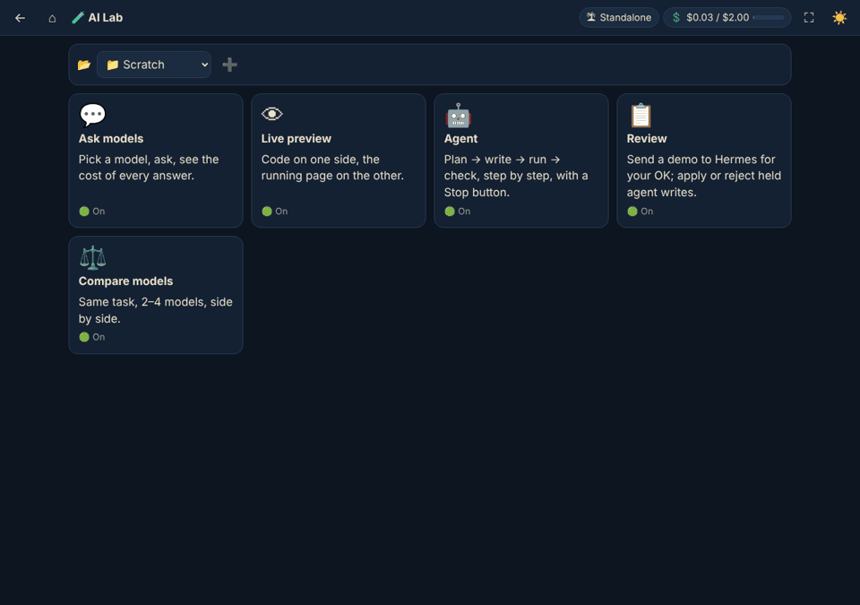

# AI Lab

A small multi-model coding lab. Ask the same task of several models (hosted or local), see cost and tokens per message, and keep spending under a daily cap.

It runs **standalone**, or **connected** to a Hermes install through the Hermes MCP server.



*Scripted demo run (fake model replies, real UI and sandbox): the same footer task given to three models, each in its own sandboxed copy, with time, cost, tokens, steps and checks side by side.*

## Status

| Part | State |
|---|---|
| Provider layer (OpenAI-compatible + Claude) | built (M2) |
| UI + router chat | built (M3) — flag `router` |
| Live preview (served from the `srt` sandbox) | built (M4) — flag `preview` |
| Agent loop (plan → write → run → check) | built (M5) — flag `agent` |
| 📋 Review (demos to Hermes, held writes) | built (M6) |
| ⚖️ Compare models (2–4 side by side) | built (M8) — flag `compare` (needs `agent`) |

Every working part sits behind a flag in `~/.config/ailab/config.json` → `"flags"`, all off on a fresh install. No endpoint can change a flag.

## ⚖️ Compare models

Pick a task, 2–4 models and (optionally) checks — shell commands such as `grep -q footer index.html`; exit 0 = pass.

- Each model runs the agent loop in **its own copy** of the project, in the sandbox (no network, writes only in its copy), one after another.
- One **$ cap per comparison** (`compare_cap_usd`, default $0.50), split evenly across the models and always inside the daily cap. ⏹ Stop ends the current model and skips the rest.
- Each model gets: time, cost, tokens, steps, checks passed, and a 📸 screenshot (desktop browser).
- The result is saved as a static page (`📄 Open saved page`) and can go to 📋 Review as a portfolio piece.
- Sensitive projects: Ollama models only, checked before anything is copied or sent.

## Providers

One OpenAI-compatible adapter covers **OpenRouter**, **Hugging Face router**, **Qwen (DashScope)**, **Kimi (Moonshot)** and **Ollama** (local). A second adapter talks to the **Claude API** directly. Model lists come from each provider's live `/models` endpoint and are cached for 24 h.

## Privacy rules (enforced in code, before any request)

- A project marked `"sensitive": true` can only use **Ollama** on `127.0.0.1`.
- OpenRouter calls always ask for **zero data retention** and providers that do not train on prompts.
- The DeepSeek first-party API host is blocked (use DeepSeek models through OpenRouter instead).

## Before publishing this repo

```bash
python3 -m ailab secretscan     # tracked files + git history; prints where, never the value
bash tools/install_test.sh      # fresh clone, no config, no Hermes: tests + status + scan
bash tools/publish_repo.sh      # all of the above, then pushes only if you type: publish
```

Fake keys used by tests are marked `secretscan: test-fixture`; fakes already in history are listed by sha256 in `.secretscan-allow`.

## Install

Python 3.10+, standard library only. `keyring` is optional.

```bash
git clone <this repo> ailab && cd ailab
python3 -m unittest discover -s tests      # or: python3 -m pytest -q
python3 -m ailab status
```

## Run the UI

```bash
python3 -m ailab serve            # http://127.0.0.1:8850/  (127.0.0.1 only)
```

Dark by default with a light toggle, full screen, phone-friendly. The start page offers paths
(💬 Ask models · 👁 Live preview · 🤖 Agent · ⚖️ Compare). Each part stays **switched off** until it is
turned on in `~/.config/ailab/config.json` → `"flags"`; the page has no switch for this on purpose.
Typing is autosaved to a recovery log in `~/.config/ailab/recovery/`.

## Keys (standalone)

Keys never live in this repo. Order: OS keyring (service `ailab`) → environment → `~/.config/ailab/keys.env`.

```bash
mkdir -p ~/.config/ailab && touch ~/.config/ailab/keys.env && chmod 600 ~/.config/ailab/keys.env
# then add lines such as: OPENROUTER_API_KEY=...   ANTHROPIC_API_KEY=...   HF_TOKEN=...
```

The Lab refuses a key file that other users can read, or one inside the repo.

## Caps

- Standalone: local ledger at `~/.config/ailab/ledger.json`, **$2/day** by default.
- Connected: hosted calls are made **by Hermes** (`llm_call`): Hermes checks the cap, uses its own stored key and records the cost (category `ailab`), so there is one budget and the Lab never holds a key. Ollama still runs locally.
- A single comparison run is capped at **$0.50**.
- Before each hosted call the Lab estimates the cost (deliberately on the high side) and refuses if the cap would be crossed. Models with no known price use a high fallback price.

## Settings

`~/.config/ailab/config.json` (all optional):

```json
{"mode": "standalone", "daily_cap_usd": 2.0,
 "prices_per_mtok": {"claude/<model-id>": {"in": 3.0, "out": 15.0}},
 "base_urls": {"qwen": "https://..."}}
```

Connected mode: `"mode": "connected"`, plus `hermes_mcp_url` and `hermes_token_file` if not the defaults.

## Licence

MIT — see `LICENSE`.
